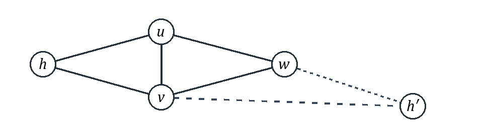

# Additive Gaps for Edge-Clique Partitions of Split Graphs II. Stability of Host Transfer

**Juan Pablo Traverso Gianini** 
Independent researcher, Santiago, Chile 
[jtraverso@gmail.com](mailto:jtraverso@gmail.com) 
[ORCID 0009-0003-6068-4096](https://orcid.org/0009-0003-6068-4096)

*Preprint 1.0 · November 22, 2026*

DOI <https://doi.org/10.5281/zenodo.24452724>  
Official repository <https://github.com/jtraverso/split-clique-partition-gap-ii>

## Abstract

Let $G$ be a split graph with clique core $V$ of size $c$. If the host neighborhoods are independent in a residual graph $B$ on $V$, a proper host assignment missing $L$ required pairs determines the additive edge-clique partition gap $\Delta(G)$ to within $2L$ of the residual packing gap $F(B)-I(B)$. The error in each direction depends on the capacity left unused by the corresponding optimal packing. For the examples in Part I, the nearly quadratic lower bound survives arbitrary deletion of $O(n^{2-\varepsilon})$ crossing edges for each fixed $\varepsilon>0$. When only the surviving neighborhoods are known, matchings among pairs with short lists bound the loss. With $2c$ hosts the gap is zero whenever each core vertex misses at most $\lfloor c/2\rfloor$ hosts. Deleting exactly that many edges at each core vertex therefore allows $c\lfloor c/2\rfloor$ deletions, however the omitted host sets overlap. We also derive recovery bounds by sampling a matching from each host's matching polytope and by choosing a single matching in a hypergraph of compatible assignments.

## 1. Partial host assignments

In a clique partition of a finite simple graph $G$, each edge belongs to exactly one of the chosen cliques. Write $\operatorname{cp}(G)$ for the least number of cliques in such a partition. A fractional clique partition assigns a nonnegative weight to each clique so that the weights on every edge sum to one, and the minimum total weight of such an assignment is $\operatorname{cp}^{\ast}(G)$. Throughout, the cliques used as pieces have at least two vertices and may have arbitrary order. We write

$$
\Delta(G)=\operatorname{cp}(G)-\operatorname{cp}^{\ast}(G).
$$

Every integral partition is feasible for the fractional problem, so $\Delta(G)\ge0$. The split graphs in the first paper [1] have a clique $V$, called the core, and an independent set $H$. A vertex $h\in H$ is a *host*, with neighborhood $N_h\subseteq V$. In that construction, a graph $B$ on $V$ determines which core pairs require a host. Every such pair $uv$ has a designated host $h$ for which $huv$ is a triangle. If the edge $hu$ is deleted, the pair $uv$ is still present in the core, but the designated triangle is gone. The question is how much of the original gap survives.

Fix a graph $B$ on $V$ and put $J=\binom{V}{2}\setminus E(B)$. All pairs of $V$ are edges of the split graph $G$, including the pairs in $J$. For $Q\subseteq V$ with $|Q|\ge2$, let $e_B(Q)$ be the number of edges of $B$ with both ends in $Q$, and give $Q$ the score

$$
w(Q)=2e_B(Q)-\binom{|Q|}{2}-1.
$$

The first term in the following expression is the saving from using $Q$ in place of its individual edges. Each required pair occupied by $Q$ also displaces a possible host triangle, whose saving is two. Thus the score measures the net saving on the core:
$$
w(Q)=\left(\binom{|Q|}{2}-1\right)-2\left|J\cap\binom{Q}{2}\right|.
$$

A *residual packing* is a collection of such sets in which each pair of $V$ occurs at most once. Write $I(B)$ for its maximum total score, allowing the empty collection. In a fractional residual packing, the variables $y_Q\ge0$ satisfy

$$
\sum_{Q\supseteq e}y_Q\le1 \qquad \left(e\in\binom{V}{2}\right).
$$

Write $F(B)$ for the maximum of $\sum_Q y_Qw(Q)$. This maximum exists because every $Q$ contains a pair, so $y_Q\le1$, and the feasible set is a closed subset of a finite-dimensional unit cube. The empty packing is feasible in both problems.

A *proper host assignment* on $J_0\subseteq J$ chooses, for each $uv\in J_0$, a host $h$ with $u,v\in N_h$. The pairs assigned to any one host must form a matching. The assigned triangles are pairwise edge-disjoint because their core edges are distinct and any two using the same host have disjoint core endpoints. We use host assignments in the sense of [3, §5].

**Theorem 1 (stability of host transfer).** Suppose that each $N_h$ is independent in $B$. If $J_0\subseteq J$ admits a proper host assignment and $L=|J\setminus J_0|$, then

$$
\big|\Delta(G)-(F(B)-I(B))\big|\le 2L. \tag{1}
$$

When $J_0=J$, (1) recovers the exact gap identity in [1, Lemma 2.1]. For an incomplete assignment, we adjoin a private host of degree two for each unassigned pair and then restrict the resulting graph to its original vertices. Section 3 applies this estimate to deletions from an existing witness. Sections 4–6 estimate how many pairs can be assigned from the surviving neighborhoods alone. Section 4 counts matchings of pairs with deficient lists. Sections 5 and 6 exploit overlapping choices through matching polytopes and pseudorandom hypergraph matchings, respectively. Paper VI [4] studies partition optima near complete split graphs and supplies the list-coloring tools for Section 4.

## 2. The proof of stability

**Lemma 2 (exact transfer [1, Lemma 2.1]).** Under the hypotheses of Theorem 1, if $J_0=J$, then

$$
\begin{aligned}
\operatorname{cp}(G)   &= |E(G)|-2|J|-I(B),\\
\operatorname{cp}^{\ast}(G) &= |E(G)|-2|J|-F(B).
\end{aligned} \tag{2}
$$

*Proof.* Use the partition into individual edges as a reference. A clique $K$ saves $\binom{|K|}{2}-1$ pieces. The same count holds for fractional partitions. Indeed, if $x_K$ denotes the weight of $K$, summing the unit loads over the edges gives

$$
|E(G)|=\sum_{e\in E(G)}\sum_{K\supseteq e}x_K
       =\sum_K x_K\binom{|K|}{2}.
$$

Subtracting the cost $\sum_Kx_K$ gives the total saving. An integral partition is the case in which the chosen cliques have weight one.

Put $j(Q)=|J\cap\binom{Q}{2}|$. Since $e_B(Q)+j(Q)=\binom{|Q|}{2}$, the saving on a clique contained in the core is

$$
\binom{|Q|}{2}-1=w(Q)+2j(Q). \tag{3}
$$

Every other clique consists of one host and $u\ge1$ of its neighbors. These $u$ vertices span only pairs of $J$, because the host neighborhood is independent in $B$. Its saving can be charged to those pairs at two units per pair. In fact,

$$
2\binom u2-\left(\binom{u+1}{2}-1\right)
=\frac{(u-1)(u-2)}2\ge0
$$

for every integer $u\ge1$. Now take any clique partition. Its core cliques form a residual packing, so their total score is at most $I(B)$. The additional charges from (3) and from the cliques containing hosts sum to at most $2|J|$, since each pair of $J$ is covered once. With fractional weights, the core cliques satisfy the same pair capacities, and the total weight at each pair of $J$ is still one. The saving is therefore at most $I(B)+2|J|$ in the integral case and $F(B)+2|J|$ in the fractional case.

For the reverse bounds, start with an optimal residual packing. Write $y_Q$ for its coefficients, using zero and one in the integral case, and set $\ell_e=\sum_{Q\supseteq e}y_Q$ for each core pair $e$. Keep the core cliques at weights $y_Q$. For each $e=uv\in J$ with assigned host $h$, give $huv$ weight $1-\ell_e$. This fills $e$ to weight one. The matching condition ensures that the crossing edges $hu$ and $hv$ occur in no other assigned triangle, so their loads also remain at most one. Give each edge of $G$ its remaining weight as an individual edge. This is an exact fractional partition. If the starting coefficients are integral, every remaining weight is zero or one, and the same construction is an integral partition.

By (3), the core cliques save $\sum_Q y_Qw(Q)+2\sum_{e\in J}\ell_e$. The assigned triangles save $2\sum_{e\in J}(1-\ell_e)$, and the individual edges contribute zero saving. Addition gives the residual score plus $2|J|$ in each case. Subtracting these savings from $|E(G)|$ proves (2).

**Lemma 3 (induced restriction).** Let $K$ be an induced subgraph of a finite simple graph $X$. Suppose that the graph with edge set $E(X)\setminus E(K)$ admits a clique partition with $p$ pieces. Then

$$
|\Delta(X)-\Delta(K)|\le p. \tag{4}
$$

*Proof.* Intersect each clique of a partition of $X$ with $V(K)$ and discard intersections of size less than two. Every remaining set is a clique of $K$. Each edge of $K$ still belongs to the restriction of its unique original piece. Hence $\operatorname{cp}(K)\le\operatorname{cp}(X)$.

For a fractional partition, add the weights of all cliques with the same surviving intersection. For any edge $ab$ of $K$, the cliques contributing at $ab$ are precisely the original cliques containing $a$ and $b$. Their total weight remains one. Discarding the smaller intersections can only decrease the cost. Thus $\operatorname{cp}^{\ast}(K)\le\operatorname{cp}^{\ast}(X)$ as well.

Conversely, adjoin the $p$ given cliques to an optimal partition of $K$. Their edges are disjoint from $E(K)$ and cover all the remaining edges of $X$. This increases the integral cost by $p$, and assigning weight one to the same $p$ cliques gives the corresponding fractional extension. The increments $\operatorname{cp}(X)-\operatorname{cp}(K)$ and $\operatorname{cp}^{\ast}(X)-\operatorname{cp}^{\ast}(K)$ both lie in $[0,p]$. Their difference lies in $[-p,p]$, which proves (4).

*Proof of Theorem 1.* For each $e=uv\in J\setminus J_0$, add a distinct vertex $h_e$ with neighborhood $\{u,v\}$. Call the resulting graph $G^+$. Since $uv\notin E(B)$, the new neighborhood is independent in $B$. Assign $e$ to $h_e$ and retain the old assignment on $J_0$. The pairs at an old host still form the same matching, and a new host receives only one pair. Formula (2) therefore gives $\Delta(G^+)=F(B)-I(B)$.

The original vertices induce $G$ in $G^+$. The edges outside $G$ are exactly $h_eu,h_ev$ for the $L$ new hosts. Taking these $2L$ edges individually in Lemma 3 gives (1).

For an illustration with a three-vertex core, take $V=\{u,v,w\}$, $E(B)=\{uw\}$ and one host $h$ with neighborhood $\{u,v\}$. The assignment realizes $uv$ but misses $vw$. In Figure 1 the dotted edges are the two added in the proof. Deleting their common endpoint recovers the original graph, including the core edge $vw$.

*Figure 1. Completing the assignment at the pair $vw$. The solid edges belong to the original split graph.*

**Lemma 4 (unused capacity on missing pairs).** Under the hypotheses of Theorem 1, write $M=J\setminus J_0$ and $\Phi(B)=F(B)-I(B)$. Let $\ell_e^I$ and $\ell_e^F$ be the loads of any chosen optimal integral and fractional residual packings. Then
$$
\Phi(B)-2\sum_{e\in M}(1-\ell_e^F)
\ \le\ \Delta(G)\ \le\
\Phi(B)+2\sum_{e\in M}(1-\ell_e^I). \tag{5}
$$

*Proof.* Write $A=|E(G)|-2|J|$. The upper bounds on savings in the first half of Lemma 2 used only the independence of the host neighborhoods. They give the two lower bounds $A-I(B)\le\operatorname{cp}(G)$ and $A-F(B)\le\operatorname{cp}^{\ast}(G)$. For the upper bounds on costs, carry out the construction in the second half using only the triangles assigned on $J_0$. For any residual packing of score $s$ and loads $\ell_e$, its core cliques save $s+2\sum_{e\in J}\ell_e$, and the available triangles save $2\sum_{e\in J_0}(1-\ell_e)$. The remaining edge capacities are filled individually, so the resulting cost is $A-s+2\sum_{e\in M}(1-\ell_e)$. Integral input again gives integral output. Let $R_I$ and $R_F$ denote twice the total unused capacity on $M$ in the chosen integral and fractional optima. The bounds just proved give
$$
\begin{aligned}
A-I(B)&\le\operatorname{cp}(G)\le A-I(B)+R_I,\\
A-F(B)&\le\operatorname{cp}^{\ast}(G)\le A-F(B)+R_F.
\end{aligned}
$$
Subtracting the upper endpoint of the second interval from the lower endpoint of the first gives $\Phi(B)-R_F$. The opposite endpoints give $\Phi(B)+R_I$, proving (5).

In particular, equality $\Delta(G)=\Phi(B)$ still holds if an integral optimum and a fractional optimum each saturate every missing pair. Section 3 places the best universal coefficient for crossing-edge deletions from a complete assignment between one and two.

## 3. Deleting crossing edges from a witness

**Corollary 5.** Let $G$ have a complete assignment as in (2). If $G'$ is obtained from $G$ by deleting $q$ edges between $V$ and $H$, then

$$
|\Delta(G')-\Delta(G)|\le 2q. \tag{6}
$$

*Proof.* A pair keeps its designated host if both crossing edges of its triangle survive. For each lost pair, one of the deleted edges witnesses the loss. These witness edges are distinct because two pairs incident to $u$ and assigned to $h$ would violate the matching condition at $h$. Thus at most $q$ pairs are lost, even when both crossing edges of a designated triangle are deleted.

The remaining pairs keep a proper assignment in $G'$. Shrinking a host neighborhood preserves its independence in $B$, and the core and $B$ are unchanged. Apply Theorem 1 to $G'$ and substitute $F(B)-I(B)=\Delta(G)$ from (2).

For the witnesses of [1, Theorem 1.1], there are absolute constants $a_0>0$ and $n_0$ such that for each $n\ge n_0$ the original gap is at least

$$
f(n)=\frac{a_0 n^2}{(\log n)^{5/2}}
      \exp\!\left(-2\sqrt{\log(24/7)\log n}\right),
$$

where logarithms are natural. After any $q_n$ crossing-edge deletions the resulting graph still has $n$ vertices, including hosts left isolated, and (6) gives $\Delta(G'_n)\ge f(n)-2q_n$. In particular, for fixed $\varepsilon>0$ and $q_n=O(n^{2-\varepsilon})$, the ratio $q_n/f(n)$ tends to zero. Indeed its logarithm, when $q_n>0$, is at most
$$
-\varepsilon\log n+2\sqrt{\log(24/7)\log n}+\tfrac52\log\log n+O(1),
$$
which tends to $-\infty$. Thus $\Delta(G'_n)\ge(1-o(1))f(n)$, whether or not the deletions preserve connectivity.

**A gap that rises and falls.** On the core $V=\{0,1,2,3,4,5\}$ take
$$
E(B)=\{05,12,14,15,23,24,25,34,45\},
$$
where $ij$ denotes the unordered pair $\{i,j\}$. Each of the six remaining pairs has its own host adjacent to its two ends. First delete the edge from the host of $01$ to $0$, then the edge from the host of $03$ to $0$. Corollary 5 keeps $B$ fixed to bound the change. To compute the optima exactly in each row, we instead move the affected pair into $B$ after each deletion. The affected host now has degree one, so its neighborhood remains independent in the enlarged residual graph. The other hosts still realize a complete assignment on the new $J$. In deletion order the pairs $(|E(G)|,|J|)$ are $(27,6),(26,5),(25,4)$, so the common term $|E(G)|-2|J|$ in (2) takes the values $15,16,17$.

| Crossing edges deleted | $I(B)$ | $F(B)$ | $\operatorname{cp}(G)$ | $\operatorname{cp}^{\ast}(G)$ | $\Delta(G)$ |
|---|---:|---:|---:|---:|---:|
| Neither | 5 | 5 | 10 | 10 | 0 |
| At $01$ | 5 | 6 | 11 | 10 | 1 |
| At $01$ and $03$ | 6 | 6 | 11 | 11 | 0 |

Writing a string of vertices for the corresponding subset of $V$, fractional packings attaining the three values use, respectively, the set $12345$ with weight one, the four sets $0125,0145,1234,2345$ with weight one half each, and the whole core with weight one. For upper bounds, assign nonnegative prices to pairs so that the sum on every subset $Q$ is at least $w(Q)$. In the first row the nonzero prices are $15:2,\ 24:3$. In the second they are $15:3,\ 24:2,\ 34:1$. In the third they are two on $15$, one on $24$, and one half on each of $12,14,23,25,34,45$. Summing the price inequalities against a feasible fractional packing counts each price at most once. The price totals are $5,6,6$.

In the middle row, an integral packing of score six would attain the total dual price. It would therefore cover each positive-price pair $15,24,34$ and use only tight sets, those whose score equals the sum of their pair prices. Checking the subsets containing $34$ gives just two tight choices, $1234$ and $2345$. The tight choices containing $15$ are $0125,0145,1245,01245$. Each choice in the first list shares a pair with each choice in the second, so an integral packing cannot attain six. The sets $234$ and $0145$ share only vertex $4$ and have scores two and three. They attain five.

For the integral optima let $T(A)$ be the maximum residual score using only the available core pairs $A$. If no positive-score subset has all its pairs in $A$, then $T(A)=0$. Otherwise $T(A)$ is the maximum of zero and $w(Q)+T(A\setminus\binom Q2)$ over those subsets. The recursion is exact because any nonempty optimal positive-score packing contains one such $Q$ and its other pieces avoid every pair of $Q$. The companion's short verifier evaluates it on the fifteen available pairs and checks every price and packing inequality in rational arithmetic. The respective maximizing packings include $1245$, the pair of sets $234,0145$, and $012345$. Substitution in (2) gives the two partition numbers in each row.

These unit changes add over arbitrarily many copies. For a disjoint union of residual graphs, projecting a piece $Q$ onto its $m$ nonempty block intersections gives a total of the block scores exceeding $w(Q)$ by the number of cross-block pairs in $Q$ minus $(m-1)$. This difference is nonnegative since there are at least $\binom m2$ such pairs. In this calculation a singleton has score $-1$, so dropping it only increases the projected score. Projection preserves capacities within each block, and conversely block packings can be combined without conflict. This proves additivity of both residual optima, also for fractional coefficients. On the union core, supply private hosts for all cross-block pairs as well as the original hosts in each block. One deletion per copy then raises the gap by $q$ on $q$ copies. Starting at the middle row in each copy and making the second deletion lowers it by $q$. Thus the smallest universal coefficient for crossing-edge deletions starting from a complete assignment in Corollary 5 lies in $[1,2]$. Its exact value remains open.

**Proposition 6 (changes to the residual graph).** Suppose $B,B'$ are graphs on the same core and $b=|E(B)\mathbin{\triangle} E(B')|$. Then
$$
|\Phi(B')-\Phi(B)|\le 2b. \tag{7}
$$
*Proof.* Adding one edge $e$ raises the score of any fixed feasible packing by twice its load at $e$, an amount in $[0,2]$. The feasible sets depend only on the core pairs. Evaluating an optimal packing for $B$ under the score function $w_{B'}$ shows that neither optimum can decrease. Evaluating an optimal packing for $B'$ under $w_B$ bounds each increase by two. The difference between the two increases therefore lies in $[-2,2]$. Reversing the argument handles a deletion, and summing along the $b$ edits gives (7). For split graphs with respective independent host neighborhoods and assignments missing $L,L'$ pairs, (1) at both ends yields $|\Delta(G')-\Delta(G)|\le 2(L+b+L')$.

## 4. Reading the loss from the host lists

Write $c=|V|$ and regard $J$ also as the graph of required pairs on $V$. The list at $e=uv$ is $L_e=\{h\in H:u,v\in N_h\}$. Let $k$ be a nonnegative integer such that every assignment of lists of size at least $k$ to the edges of $J$ admits a proper edge coloring from those lists. Equivalently, $k\ge\chi'_\ell(J)$. For $1\le t\le k$, define
$$
d_k(e)=(k-|L_e|)_+,\qquad
E(D_t^{(k)})=\{e\in J:d_k(e)\ge t\},
$$
where $x_+=\max\{x,0\}$. Each deficiency graph has vertex set $V$. We write $\nu(D)$ for its maximum matching size.

**Proposition 7 (short lists).** If every $N_h$ is independent in $B$, then
$$
|\Delta(G)-(F(B)-I(B))|\le 2\sum_{t=1}^{k}\nu(D_t^{(k)}). \tag{8}
$$

*Proof.* The hosts serve as colors. Besides them we use distinct auxiliary colors $\alpha_1,\ldots,\alpha_k$. Each $e\in J$ receives the list
$$
L_e\cup\{\alpha_t:1\le t\le d_k(e)\},
$$
of size at least $k$. In a proper coloring from these lists, the pairs receiving a host color form a proper host assignment. Every remaining pair has a unique auxiliary color $\alpha_t$, whose entire color class is a matching in $D_t^{(k)}$. Hence the sum in (8) counts an upper bound on the number of discarded pairs, even when a pair belongs to several deficiency levels. Theorem 1 gives the claim.

Häggkvist and Janssen [2, Theorem 1.1] show that lists of size $c$ suffice for $K_c$. They also suffice for $J$, since arbitrary lists of that size on the other core pairs extend the instance to $K_c$. If $J$ has maximum degree $d\ge1$, an edge meets at most $2d-2$ other edges. Coloring in any order from lists of size $2d-1$ therefore always leaves a color available. Either argument applies, giving $k=\min\{c,2d-1\}$. For a nonempty matching one may take $k=1$. For empty $J$ the assignment is complete and Theorem 1 applies directly.

The graphs $D_t^{(k)}$ are nested. With $d_{\max}=\max_{e\in J}d_k(e)$ (zero for empty $J$), at most $d_{\max}$ of them have edges, so the bound in (8) is at most $2d_{\max}\nu(D_1^{(k)})$ for $k\ge1$. Small vertex covers give convenient certificates for these matching numbers. For example, if all deficient pairs meet the same two vertices, each level contributes at most two. More generally, by the Tutte–Berge formula [7], any $S\subseteq V$ certifies the upper bound $(c+|S|-o(D_t^{(k)}-S))/2$, where $o$ counts odd components, and some $S$ attains equality.

In the next corollary we take $k=c$ and abbreviate $D_t^{(c)}$ to $D_t(J)$.

**Corollary 8.** For every split presentation with core $V$, put $J=\binom{V}{2}$ and form the graphs $D_t(J)$ from the given neighborhoods. Then

$$
\Delta(G)\le 2\sum_{t=1}^{c}\nu(D_t(J)). \tag{9}
$$

If $|H|\ge2c$, let $M_u=\{h\in H:u\notin N_h\}$ and $s_u=(|M_u|-\lfloor c/2\rfloor)_+$. Then
$$
\Delta(G)\le 2\sum_{u\in V}s_u. \tag{10}
$$
In particular, if at most $r$ vertices have positive excess $s_u$ and each excess is at most $r$, then $\Delta(G)\le2r^2$. This gives $\Delta(G)\le2c$ whenever $r^2\le c$.

*Proof.* Take $B$ to be the edgeless graph on $V$. Every host neighborhood is independent in $B$, and each residual set $Q$ has score $-\binom{|Q|}{2}-1<0$. The empty packing attains both optima at zero, giving (9) from (8) with $k=c$.

For each pair $uv$ we have
$$
|L_{uv}|=|H|-|M_u\cup M_v|\ge 2c-2\lfloor c/2\rfloor-s_u-s_v\ge c-s_u-s_v .
$$
Give each $u$ its own set $A_u$ of $s_u$ auxiliary colors. These sets are mutually disjoint and avoid the hosts. The list $L_{uv}\cup A_u\cup A_v$ has at least $c$ colors, so [2] gives a proper coloring. A color belonging to $A_u$ is available only on edges incident to $u$, and properness allows at most one of those edges to use it. Discarding the edges with auxiliary colors therefore loses at most $\sum_u s_u$ pairs. The remaining colors give a proper host assignment, and (1) yields (10). Under the stated hypothesis the sum has at most $r$ nonzero terms of size at most $r$.

For $2c$ hosts, suppose each core vertex misses an arbitrary set of $\lfloor c/2\rfloor$ of them. Then $c\lfloor c/2\rfloor$ crossing edges are absent, yet every core pair has at least $c$ common hosts. Every positive deficiency level is empty, so $\Delta(G)=0$ even with, for example, $5{,}000$ missing crossing edges when $c=100$. Conversely, a gap of size $g$ forces the sum of the matching numbers in (9) to be at least $g/2$ in every split presentation.

## 5. Redundancy at individual hosts

A list records the choices for one pair. To keep track of choices that can be used together, consider the graph $J_h$ of required pairs within $N_h$. For each $h$ let $x^h$ be a nonnegative vector on its edges, extended by zero on other pairs. Suppose the sum of its entries incident to each vertex is at most one and
$$
\sum_{e\in E(J_h[U])}x^h_e\le (|U|-1)/2
$$
for every odd set $U\subseteq N_h$. These are Edmonds' matching polytope inequalities [5]. Set $\lambda_e=\sum_h x^h_e$ and $p_e=\prod_h(1-x^h_e)$, using one for the empty product.

**Theorem 9 (recovery from overlapping choices).** If each $N_h$ is independent in $B$, then
$$
|\Delta(G)-\Phi(B)|\le 2\sum_{e\in J}p_e
                  \le 2\sum_{e\in J}\exp(-\lambda_e). \tag{11}
$$
More precisely, (5) holds with each of its two sums replaced by $\sum_{e\in J}p_e(1-\ell_e)$, using the corresponding fractional or integral optimum.

*Proof.* Edmonds' theorem expresses $x^h$ as a convex combination of incidence vectors of matchings of $J_h$. Drawing a matching with those probabilities selects $e$ at $h$ with probability $x^h_e$. We draw independently at different hosts. A pair is missed with probability exactly $p_e$, and $p_e\le\exp(-\lambda_e)$ follows from $1-x\le e^{-x}$ for $x\ge0$. When a pair is selected at several hosts, we keep it at the first in a fixed order. Removing the other copies preserves the matching at each host, so each outcome gives a proper partial assignment. Inequality (5) holds on every outcome with the same $\Delta(G)$ and the same chosen optimal packings. Taking expectations on its two sides gives the weighted bounds. Since $0\le1-\ell_e\le1$, they imply (11).

For a family on $n$ vertices with $\Phi(B)\ge f(n)$ as in Section 3, a sufficient condition for preserving $(1-o(1))f(n)$ is
$\min_{e\in J}\lambda_e\ge(C+\gamma)\sqrt{\log n}$, where $C=2\sqrt{\log(24/7)}$ and $\gamma>0$ is fixed. Indeed $|J|\le n^2$, and the ratio of the error in (11) to $f(n)$ is at most $(2/a_0)(\log n)^{5/2}\exp(-\gamma\sqrt{\log n})$, which tends to zero. Here $a_0$ is the leading constant in $f(n)$ from Section 3.

The witnesses with universal vertices in [1, §§5–6] illustrate a limitation of this condition. They have a set $W$ of $w=\lceil n/5\rceil$ core vertices isolated in $B$ and adjacent to every host. Fix $u\in W$. All $w-1$ pairs from $u$ to $W\setminus\{u\}$ have the full host list, yet the degree constraint at $u$ gives
$$
\sum_{v\in W\setminus\{u\}}\lambda_{uv}\le |H|.
$$
Consequently some such pair has $\lambda_{uv}\le |H|/(w-1)\le(n-w)/(w-1)=4+o(1)$. The uniform threshold of order $\sqrt{\log n}$ therefore exceeds the redundancy available in this presentation, whose robustness in Section 3 follows from retaining the designated triangles.

## 6. Simultaneous recovery

To record both causes of conflict between candidate triangles, form a hypergraph whose vertices are the required pairs and the crossing incidences $(h,u)$ with $u\in N_h$, taken as disjoint classes. A candidate $huv$ gives the hyperedge $\{uv,(h,u),(h,v)\}$. A matching selects each pair at most once and uses each crossing edge at most once, precisely the conditions for a proper partial assignment. Two pair vertices never lie in one hyperedge. A pair and an incidence determine the host and both endpoints, and two incidences in one hyperedge also determine the triangle. Thus distinct vertices have codegree at most one.

Write $S=\sum_{e\in J}|L_e|$ for the number of hyperedges. The degree of $e$ is $|L_e|$ and the degree of $(h,u)$ is $d_{J_h}(u)$. Under neighborhood independence every pair of $N_h$ belongs to $J$, so the latter degree equals $|N_h|-1$ for $u\in N_h$. Both kinds of degrees enter the choice of $D$ below.

**Proposition 10.** Fix $0<\delta<1$ and put $\epsilon=\delta/450$. For sufficiently large $D$ depending on $\delta$, suppose all the above degrees are at most $D$ and
$$
D^{1+\delta}\le S\le\exp(D^{\epsilon^2}).
$$
Under the independence hypothesis of Theorem 1,
$$
|\Delta(G)-\Phi(B)|\le
2\bigl(|J|-(1-D^{-\epsilon})S/D\bigr).
$$

*Proof.* Apply the pseudorandom matching theorem of Ehard, Glock and Joos [6, Theorem 1.2] with uniformity three and the single edge weight function identically one. The codegree bound is at most $D^{1-\delta}$, the number of hyperedges obeys the upper size bound, and the total weight $S$ meets the lower bound for the theorem. There is a matching of size at least $(1-D^{-\epsilon})S/D$. Each of its hyperedges recovers one distinct pair, so Theorem 1 applies with at most $|J|-(1-D^{-\epsilon})S/D$ missing pairs. If every list has size at least $(1-\eta)D$, with $0\le\eta\le1$, substitution of $S\ge(1-\eta)D|J|$ bounds the error by $2(\eta+D^{-\epsilon})|J|$.

The degree formulas also give a test on the padded examples of [1]. Let $n_0\le n/25$ be the order before enlargement, $v_0\le n_0$ the original core size and $w=\lceil n/5\rceil$. Take $D=|H|$. This bounds every pair degree, and for sufficiently large $n$ every incidence degree is at most $v_0+w-1<|H|$. Pairs within $W$ have degree $|H|=n-v_0-w$. For $u\in W$ and an original core vertex $a$, the list of $ua$ contains the old hosts that see $a$ and exactly the $v_0+w$ new color-class hosts for the class of $a$. The final padding hosts see only $W$. Thus $|L_{ua}|\le n_0+v_0+w$, and
$$
\frac{|L_{ua}|}{D}\le\frac{2n/25+w}{n-n/25-w}
      \le\frac7{19}+o(1).
$$
In particular, the special case with $\eta=o(1)$ does not apply to all pairs in these witnesses. We can also evaluate the order of the unweighted estimate. In the notation of [1, §6], $v_0=15m^{2j}$, $j$ is of order $\sqrt{\log n}$, and $m$ is the largest odd integer at most $X=(n/(25b_j))^{1/(2j)}$, where $b_j=255+2880j$. Since $X/j\to\infty$ and $m>X-2$, we have $(m/X)^{2j}\to1$, giving $v_0=\Theta(n/\sqrt{\log n})$. Now $S\ge\binom w2D=\Theta(n^3)$ and $S\le n^3$, so both size hypotheses hold eventually for every fixed $\delta\in(0,1)$.

The discrepancy is the sum of the unused proportions of the individual lists:
$$
|J|-S/D=\sum_{e\in J}\bigl(1-|L_e|/D\bigr).
$$
Every pair within $W$ contributes zero. There are at most $wv_0+\binom{v_0}{2}$ other pairs, while the $wv_0$ pairs between $W$ and the old core each contribute at least $12/19-o(1)$. Thus $|J|-S/D=\Theta(n^2/\sqrt{\log n})$. The additional term $D^{-\epsilon}S/D$ is $O(n^{2-\epsilon})$. On these unchanged witnesses the unweighted theorem therefore recovers a $1-o(1)$ fraction of the required pairs, but its error bound is larger than $f(n)$. Corollary 5 gives the stronger perturbation conclusion here.

## 7. Formalization

The Lean 4 sources in [8] establish the two-sided transfer estimate (1), its refinement by the loads of the chosen optima (5), and both perturbation bounds (6) and (7). They also give the complete-core threshold $k=c$ in (8), the endpoint excess bound (10), and the independent-matching estimate in (11) given finite matching decompositions. The fractional residual optimum in Lean is a supremum. Compactness of the finite feasible set identifies it with the maximum used here. The repository lists the declarations and their axioms, gives build instructions, and includes the exact verifier for the example in Section 3. The general list threshold, the replication argument and the asymptotic applications have written proofs in the preceding sections.

## Acknowledgments

The author is deeply grateful to his wife María Paz and his children Lucas, Juan Cristóbal, Francisca, Raimundo and Benjamín for their love, patience and support.

## Use of artificial intelligence and computational tools

Claude, by Anthropic, and ChatGPT/Codex, by OpenAI, were used to explore and check arguments and to prepare the manuscript.

The author remains responsible for the arguments, citations, code and presentation. No AI system is listed as an author.

## References

[1] J. P. Traverso Gianini, *Nearly Quadratic Additive Gaps for Edge-Clique Partitions of Split Graphs*, preprint 1.0 (2026), Theorem 1.1 and Lemma 2.1. <https://github.com/jtraverso/split-clique-partition-gap>

[2] R. Häggkvist and J. Janssen, *New bounds on the list-chromatic index of the complete graph and other simple graphs*, Combinatorics, Probability and Computing **6** (1997), 295–313, Theorem 1.1. <https://doi.org/10.1017/S0963548397002927>

[3] J. P. Traverso Gianini, *Colorability and Realizability Defects in Resource-Dominated Packing Relaxations*, Paper V in the Erdős 81 series, §5. <https://github.com/jtraverso/erdos81-colorability-realizability-defects>

[4] J. P. Traverso Gianini, *Optimal Clique Partitions under Local Perturbations*, Paper VI in the Erdős 81 series, Lean formalization. <https://github.com/jtraverso/erdos81-optimal-clique-partitions>

[5] J. Edmonds, *Maximum Matching and a Polyhedron with 0,1-Vertices*, Journal of Research of the National Bureau of Standards B **69B** (1965), 125–130. <https://doi.org/10.6028/jres.069B.013>

[6] S. Ehard, S. Glock and F. Joos, *Pseudorandom hypergraph matchings*, Combinatorics, Probability and Computing **29** (2020), 868–885, Theorem 1.2. <https://doi.org/10.1017/S0963548320000280>

[7] J. P. Traverso Gianini, *Berge's augmenting path theorem and the Tutte–Berge formula*, Lean formalization. <https://github.com/jtraverso/berge-matching>

[8] J. P. Traverso Gianini, *Split Gap II*, source code, build instructions and exact finite example. <https://github.com/jtraverso/split-clique-partition-gap-ii>
