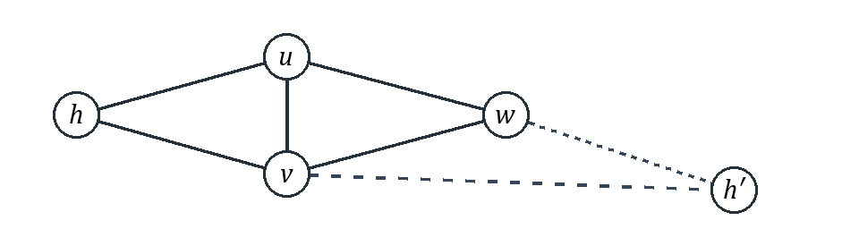

# Gaps aditivos para particiones de aristas en cliques de grafos split II. Estabilidad de la transferencia mediante hosts

**Juan Pablo Traverso Gianini** 
Investigador independiente, Santiago, Chile 
[jtraverso@gmail.com](mailto:jtraverso@gmail.com) 
[ORCID 0009-0003-6068-4096](https://orcid.org/0009-0003-6068-4096)

*Preprint 1.0 · 22 de noviembre de 2026*

DOI <https://doi.org/10.5281/zenodo.24452724>  
Repositorio oficial <https://github.com/jtraverso/split-clique-partition-gap-ii>

## Resumen

Sea $G$ un grafo split con núcleo clique $V$ de tamaño $c$. Si las vecindades de los hosts son independientes en un grafo residual $B$ sobre $V$, una asignación propia que deja $L$ pares requeridos sin cubrir determina el gap aditivo de partición en cliques $\Delta(G)$ con un error de a lo sumo $2L$ respecto del gap residual de empaquetamiento $F(B)-I(B)$. El error en cada sentido depende de la capacidad que deja libre el óptimo correspondiente. En los ejemplos de la Parte I, la cota inferior casi cuadrática persiste tras borrar arbitrariamente $O(n^{2-\varepsilon})$ aristas cruzadas para cada $\varepsilon>0$ fijo. Cuando sólo conocemos las vecindades restantes, podemos acotar la pérdida mediante matchings entre los pares de listas cortas. Con $2c$ hosts el gap es cero siempre que a cada vértice del núcleo le falten a lo sumo $\lfloor c/2\rfloor$ hosts. Borrar exactamente esa cantidad en cada vértice del núcleo permite por tanto $c\lfloor c/2\rfloor$ borrados, cualquiera que sea el solapamiento de los conjuntos omitidos. También obtenemos cotas de recuperación al muestrear un matching del politopo de cada host y al elegir un solo matching en un hipergrafo de asignaciones compatibles.

## 1. Asignaciones parciales a hosts

En una partición en cliques de un grafo simple finito $G$, cada arista pertenece a exactamente una de las cliques elegidas. Sea $\operatorname{cp}(G)$ el mínimo número de cliques de tal partición. Una partición fraccional asigna a cada clique un peso no negativo de modo que los pesos sobre cada arista sumen uno. El mínimo peso total es $\operatorname{cp}^{\ast}(G)$. Todas las piezas tienen al menos dos vértices y su orden puede ser arbitrario. Escribimos

$$
\Delta(G)=\operatorname{cp}(G)-\operatorname{cp}^{\ast}(G).
$$

Toda partición entera es factible para el problema fraccional, de modo que $\Delta(G)\ge0$. Los grafos split del primer artículo [1] tienen una clique $V$, el núcleo, y un conjunto independiente $H$. Cada vértice $h\in H$ es un *host* de vecindad $N_h\subseteq V$. En aquella construcción, un grafo $B$ sobre $V$ determina qué pares del núcleo requieren host. Cada uno de estos pares $uv$ tiene un host designado $h$ para el cual $huv$ es un triángulo. Al borrar la arista $hu$, el par $uv$ permanece en el núcleo, aunque perdemos el triángulo designado. Estudiaremos cuánto del gap original se conserva.

Fijemos un grafo $B$ sobre $V$ y pongamos $J=\binom{V}{2}\setminus E(B)$. Todos los pares de $V$ son aristas del grafo split $G$, incluidos los de $J$. Para $Q\subseteq V$ con $|Q|\ge2$, sea $e_B(Q)$ el número de aristas de $B$ con ambos extremos en $Q$. Asignamos a $Q$ la puntuación

$$
w(Q)=2e_B(Q)-\binom{|Q|}{2}-1.
$$

El primer término de la expresión siguiente es el ahorro de usar $Q$ en lugar de sus aristas individuales. Cada par requerido que ocupa $Q$ desplaza además un posible triángulo con host, cuyo ahorro es dos. La puntuación mide así el ahorro neto en el núcleo:
$$
w(Q)=\left(\binom{|Q|}{2}-1\right)-2\left|J\cap\binom{Q}{2}\right|.
$$

Un *empaquetamiento residual* es una colección de tales conjuntos en la que cada par de $V$ aparece a lo sumo una vez. Sea $I(B)$ la máxima puntuación total, admitiendo la colección vacía. En un empaquetamiento residual fraccional, las variables $y_Q\ge0$ satisfacen

$$
\sum_{Q\supseteq e}y_Q\le1 \qquad \left(e\in\binom{V}{2}\right).
$$

Denotamos por $F(B)$ el máximo de $\sum_Q y_Qw(Q)$. Cada $Q$ contiene un par, de modo que $y_Q\le1$. El conjunto factible es un subconjunto cerrado de un cubo unidad de dimensión finita y el máximo existe. El empaquetamiento vacío es factible en ambos problemas.

Una *asignación propia a hosts* sobre $J_0\subseteq J$ elige para cada $uv\in J_0$ un host $h$ tal que $u,v\in N_h$. Los pares asignados a un mismo host deben formar un matching. Los triángulos asignados son disjuntos en aristas porque sus bases son distintas y los que comparten host tienen extremos disjuntos en el núcleo. Usamos las asignaciones en el sentido de [3, §5].

**Teorema 1 (estabilidad de la transferencia mediante hosts).** Supongamos que cada $N_h$ es independiente en $B$. Si $J_0\subseteq J$ admite una asignación propia y $L=|J\setminus J_0|$, entonces

$$
\big|\Delta(G)-(F(B)-I(B))\big|\le 2L. \tag{1}
$$

Cuando $J_0=J$, (1) recupera la identidad exacta del gap de [1, Lema 2.1]. Para una asignación incompleta añadimos un host privado de grado dos por cada par sin asignar y restringimos el grafo resultante a los vértices originales. La sección 3 aplica esta estimación a los borrados en un testigo conocido. Las secciones 4–6 estiman cuántos pares se pueden asignar conociendo sólo las vecindades que quedan. La sección 4 cuenta matchings de pares con listas deficientes. Las secciones 5 y 6 aprovechan opciones que se solapan mediante politopos de matchings y matchings seudoaleatorios en hipergrafos, respectivamente. El artículo VI [4] estudia los óptimos de partición cerca de los grafos split completos y proporciona las herramientas de coloración por listas de la sección 4.

## 2. Demostración de la estabilidad

**Lema 2 (transferencia exacta [1, Lema 2.1]).** Bajo las hipótesis del Teorema 1, si $J_0=J$, entonces

$$
\begin{aligned}
\operatorname{cp}(G)   &= |E(G)|-2|J|-I(B),\\
\operatorname{cp}^{\ast}(G) &= |E(G)|-2|J|-F(B).
\end{aligned} \tag{2}
$$

*Demostración.* Tomamos como referencia la partición en aristas individuales. Una clique $K$ ahorra $\binom{|K|}{2}-1$ piezas. El mismo recuento vale para particiones fraccionales. En efecto, si $x_K$ es el peso de $K$, al sumar las cargas unitarias sobre las aristas obtenemos

$$
|E(G)|=\sum_{e\in E(G)}\sum_{K\supseteq e}x_K
       =\sum_K x_K\binom{|K|}{2}.
$$

Al restar el coste $\sum_Kx_K$ obtenemos el ahorro total. Una partición entera corresponde al caso en que las cliques elegidas tienen peso uno.

Pongamos $j(Q)=|J\cap\binom{Q}{2}|$. Como $e_B(Q)+j(Q)=\binom{|Q|}{2}$, el ahorro de una clique contenida en el núcleo es

$$
\binom{|Q|}{2}-1=w(Q)+2j(Q). \tag{3}
$$

Cualquier otra clique consta de un host y $u\ge1$ de sus vecinos. Esos $u$ vértices sólo generan pares de $J$, pues la vecindad del host es independiente en $B$. Podemos cargar el ahorro a esos pares a razón de dos unidades por par. En efecto,

$$
2\binom u2-\left(\binom{u+1}{2}-1\right)
=\frac{(u-1)(u-2)}2\ge0
$$

para todo entero $u\ge1$. Consideremos una partición en cliques. Las piezas del núcleo forman un empaquetamiento residual, luego su puntuación total es a lo sumo $I(B)$. Sumadas las cargas adicionales de (3) y las de las cliques con host, se obtiene a lo sumo $2|J|$, pues cada par de $J$ se cubre una vez. Con pesos fraccionales rigen las mismas capacidades por par en el núcleo y el peso total en cada par de $J$ sigue siendo uno. Por tanto, el ahorro no supera $I(B)+2|J|$ en el caso entero ni $F(B)+2|J|$ en el fraccional.

Para la cota inversa partimos de un empaquetamiento residual óptimo. Sean $y_Q$ sus coeficientes, ceros y unos en el caso entero, y sea $\ell_e=\sum_{Q\supseteq e}y_Q$ para cada par $e$ del núcleo. Conservamos las cliques del núcleo con pesos $y_Q$. Para cada $e=uv\in J$ con host asignado $h$, damos a $huv$ el peso $1-\ell_e$. Así $e$ queda con peso uno. La condición de matching garantiza que las aristas cruzadas $hu$ y $hv$ no aparecen en otro triángulo asignado, por lo que sus cargas tampoco superan uno. Cada arista de $G$ recibe el peso que le falta como pieza individual. Obtenemos una partición fraccional exacta. Si los coeficientes iniciales son enteros, cada peso restante es cero o uno y la construcción da una partición entera.

Por (3), las cliques del núcleo ahorran $\sum_Q y_Qw(Q)+2\sum_{e\in J}\ell_e$. Los triángulos asignados ahorran $2\sum_{e\in J}(1-\ell_e)$ y las aristas individuales no aportan ahorro. La suma en ambos casos es la puntuación residual más $2|J|$. Al restarla de $|E(G)|$ obtenemos (2).

**Lema 3 (restricción inducida).** Sea $K$ un subgrafo inducido de un grafo simple finito $X$. Supongamos que el grafo con conjunto de aristas $E(X)\setminus E(K)$ admite una partición en cliques de $p$ piezas. Entonces

$$
|\Delta(X)-\Delta(K)|\le p. \tag{4}
$$

*Demostración.* Intersecamos cada clique de una partición de $X$ con $V(K)$ y descartamos las intersecciones con menos de dos vértices. Los conjuntos que quedan son cliques de $K$. Cada arista de $K$ sigue perteneciendo a la restricción de su única pieza original. Luego $\operatorname{cp}(K)\le\operatorname{cp}(X)$.

En una partición fraccional sumamos los pesos de las cliques con la misma intersección restante. Para una arista $ab$ de $K$, las cliques que contribuyen en $ab$ son precisamente las cliques originales que contienen a $a$ y a $b$. Su peso total sigue siendo uno. Descartar las intersecciones pequeñas sólo puede reducir el coste. Así obtenemos también $\operatorname{cp}^{\ast}(K)\le\operatorname{cp}^{\ast}(X)$.

Recíprocamente, añadimos las $p$ cliques dadas a una partición óptima de $K$. Sus aristas son disjuntas de $E(K)$ y cubren todas las aristas restantes de $X$. El coste entero aumenta en $p$. Asignar peso uno a las mismas $p$ cliques da la extensión fraccional correspondiente. Los incrementos $\operatorname{cp}(X)-\operatorname{cp}(K)$ y $\operatorname{cp}^{\ast}(X)-\operatorname{cp}^{\ast}(K)$ pertenecen a $[0,p]$. Su diferencia pertenece a $[-p,p]$, lo que demuestra (4).

*Demostración del Teorema 1.* Para cada $e=uv\in J\setminus J_0$ añadimos un vértice distinto $h_e$ de vecindad $\{u,v\}$. Sea $G^+$ el grafo resultante. Como $uv\notin E(B)$, la nueva vecindad es independiente en $B$. Asignamos $e$ a $h_e$ y conservamos la asignación sobre $J_0$. Los pares de cada host antiguo siguen formando el mismo matching y cada host nuevo recibe un solo par. Por (2), $\Delta(G^+)=F(B)-I(B)$.

Los vértices originales inducen $G$ en $G^+$. Las aristas fuera de $G$ son exactamente $h_eu,h_ev$ para los $L$ hosts nuevos. Al tomar estas $2L$ aristas individualmente en el Lema 3 obtenemos (1).

Como ejemplo con tres vértices en el núcleo, tomemos $V=\{u,v,w\}$, $E(B)=\{uw\}$ y un host $h$ de vecindad $\{u,v\}$. La asignación realiza $uv$ y deja pendiente $vw$. En la figura 1, las dos aristas punteadas se añaden en la demostración. Borrar su extremo común recupera el grafo original, incluida la arista $vw$ del núcleo.

*Figura 1. Completación de la asignación en el par $vw$. Las aristas continuas pertenecen al grafo split original.*

**Lema 4 (capacidad libre en los pares sin asignar).** Bajo las hipótesis del Teorema 1, escribamos $M=J\setminus J_0$ y $\Phi(B)=F(B)-I(B)$. Sean $\ell_e^I$ y $\ell_e^F$ las cargas de sendos empaquetamientos residuales óptimos, entero y fraccional. Entonces
$$
\Phi(B)-2\sum_{e\in M}(1-\ell_e^F)
\ \le\ \Delta(G)\ \le\
\Phi(B)+2\sum_{e\in M}(1-\ell_e^I). \tag{5}
$$

*Demostración.* Sea $A=|E(G)|-2|J|$. Las cotas superiores del ahorro en la primera parte del Lema 2 sólo usaron la independencia de las vecindades de los hosts. Dan las cotas inferiores $A-I(B)\le\operatorname{cp}(G)$ y $A-F(B)\le\operatorname{cp}^{\ast}(G)$. Para acotar los costes por arriba aplicamos la segunda parte de la construcción sólo con los triángulos asignados sobre $J_0$. Si un empaquetamiento tiene puntuación $s$ y cargas $\ell_e$, sus cliques del núcleo ahorran $s+2\sum_{e\in J}\ell_e$ y los triángulos disponibles ahorran $2\sum_{e\in J_0}(1-\ell_e)$. Completamos individualmente la capacidad de cada arista, con lo que el coste es $A-s+2\sum_{e\in M}(1-\ell_e)$. De nuevo, un empaquetamiento entero da una partición entera. Sean $R_I$ y $R_F$ el doble de la capacidad libre total sobre $M$ en los óptimos entero y fraccional elegidos. Las cotas anteriores dan
$$
\begin{aligned}
A-I(B)&\le\operatorname{cp}(G)\le A-I(B)+R_I,\\
A-F(B)&\le\operatorname{cp}^{\ast}(G)\le A-F(B)+R_F.
\end{aligned}
$$
Al restar el extremo superior del segundo intervalo del extremo inferior del primero obtenemos $\Phi(B)-R_F$. Los otros dos extremos dan $\Phi(B)+R_I$, lo que demuestra (5).

En particular, vale $\Delta(G)=\Phi(B)$ si un óptimo entero y un óptimo fraccional saturan, cada uno, todos los pares sin asignar. En la sección 3 situamos entre uno y dos el mejor coeficiente universal de borrado de aristas cruzadas a partir de una asignación completa.

## 3. Borrado de aristas cruzadas en un testigo

**Corolario 5.** Sea $G$ un grafo con asignación completa como en (2). Si $G'$ se obtiene de $G$ borrando $q$ aristas entre $V$ y $H$, entonces

$$
|\Delta(G')-\Delta(G)|\le 2q. \tag{6}
$$

*Demostración.* Un par conserva su host designado si sobreviven ambas aristas cruzadas de su triángulo. Por cada par perdido elegimos una arista borrada que atestigüe la pérdida. Son distintas porque dos pares incidentes en $u$ asignados a $h$ violarían la condición de matching en $h$. Así se pierden a lo sumo $q$ pares, incluso cuando se borran ambas aristas cruzadas de un triángulo designado.

Los pares restantes conservan una asignación propia en $G'$. Reducir una vecindad preserva su independencia en $B$, y tanto el núcleo como $B$ permanecen fijos. Al aplicar el Teorema 1 a $G'$ sustituimos $F(B)-I(B)=\Delta(G)$ por (2).

Para los testigos de [1, Teorema 1.1] existen constantes absolutas $a_0>0$ y $n_0$ tales que, para cada $n\ge n_0$, el gap original es al menos

$$
f(n)=\frac{a_0 n^2}{(\log n)^{5/2}}
      \exp\!\left(-2\sqrt{\log(24/7)\log n}\right),
$$

donde los logaritmos son naturales. Tras borrar cualesquiera $q_n$ aristas cruzadas quedan $n$ vértices, incluidos los hosts que hayan quedado aislados, y (6) da $\Delta(G'_n)\ge f(n)-2q_n$. En particular, para $\varepsilon>0$ fijo y $q_n=O(n^{2-\varepsilon})$, el cociente $q_n/f(n)$ tiende a cero. En efecto, su logaritmo, cuando $q_n>0$, es a lo sumo
$$
-\varepsilon\log n+2\sqrt{\log(24/7)\log n}+\tfrac52\log\log n+O(1),
$$
que tiende a $-\infty$. Así $\Delta(G'_n)\ge(1-o(1))f(n)$, se conserve o no la conectividad tras los borrados.

**Un gap que sube y baja.** Sobre el núcleo $V=\{0,1,2,3,4,5\}$ tomamos
$$
E(B)=\{05,12,14,15,23,24,25,34,45\},
$$
donde $ij$ representa el par no ordenado $\{i,j\}$. Cada uno de los seis pares restantes tiene su propio host adyacente a ambos extremos. Primero borramos la arista del host de $01$ a $0$ y luego la del host de $03$ a $0$. El Corolario 5 mantiene fijo $B$ para acotar el cambio. Para calcular cada fila de manera exacta incorporamos en cambio el par afectado a $B$ después de cada borrado. Su host queda con grado uno, así que su vecindad sigue siendo independiente en el residual ampliado. Los demás hosts conservan una asignación completa sobre el nuevo $J$. En el orden de los borrados, los pares $(|E(G)|,|J|)$ son $(27,6),(26,5),(25,4)$, por lo que el término común $|E(G)|-2|J|$ de (2) toma los valores $15,16,17$.

| Aristas cruzadas borradas | $I(B)$ | $F(B)$ | $\operatorname{cp}(G)$ | $\operatorname{cp}^{\ast}(G)$ | $\Delta(G)$ |
|---|---:|---:|---:|---:|---:|
| Ninguna | 5 | 5 | 10 | 10 | 0 |
| En $01$ | 5 | 6 | 11 | 10 | 1 |
| En $01$ y $03$ | 6 | 6 | 11 | 11 | 0 |

Representemos por una sucesión de vértices el subconjunto correspondiente de $V$. Los empaquetamientos fraccionales que alcanzan los tres valores usan, respectivamente, $12345$ con peso uno, los cuatro conjuntos $0125,0145,1234,2345$ con peso un medio cada uno y el núcleo completo con peso uno. Para la cota superior asignamos precios no negativos a los pares de modo que en todo subconjunto $Q$ la suma de los precios sea al menos $w(Q)$. En la primera fila los precios no nulos son $15:2,\ 24:3$. En la segunda son $15:3,\ 24:2,\ 34:1$. En la tercera asignamos dos a $15$, uno a $24$ y un medio a cada uno de $12,14,23,25,34,45$. Al sumar las desigualdades de precios contra un empaquetamiento fraccional factible, cada precio se cuenta a lo sumo una vez. Los totales son $5,6,6$.

En la fila central, un empaquetamiento entero de puntuación seis alcanzaría el precio dual total. Tendría que cubrir cada par de precio positivo $15,24,34$ y usar únicamente conjuntos ajustados, aquellos cuya puntuación iguala la suma de los precios de sus pares. Entre los subconjuntos que contienen $34$ sólo dos son ajustados, $1234$ y $2345$. Los ajustados que contienen $15$ son $0125,0145,1245,01245$. Cada conjunto de la primera lista comparte un par con cada conjunto de la segunda, de modo que seis es inalcanzable. Los conjuntos $234$ y $0145$ comparten únicamente el vértice $4$ y sus puntuaciones, dos y tres, suman cinco.

Para calcular los óptimos enteros sea $T(A)$ la máxima puntuación residual usando sólo los pares disponibles $A$ del núcleo. Si ningún subconjunto de puntuación positiva tiene todos sus pares en $A$, entonces $T(A)=0$. En otro caso $T(A)$ es el máximo de cero y de $w(Q)+T(A\setminus\binom Q2)$ sobre tales subconjuntos. La recurrencia es exacta porque un empaquetamiento óptimo no vacío de piezas de puntuación positiva contiene una de ellas, $Q$, y sus demás piezas evitan todos los pares de $Q$. El verificador adjunto evalúa la recurrencia sobre los quince pares disponibles y comprueba con aritmética racional cada desigualdad de precios y de capacidad. Entre los empaquetamientos que alcanzan el máximo figuran $1245$, los dos conjuntos $234,0145$ y el conjunto $012345$, respectivamente. Sustituyendo en (2) se obtienen los dos números de partición de cada fila.

Estos cambios unitarios se suman sobre un número arbitrario de copias. En una unión disjunta de grafos residuales, proyectemos una pieza $Q$ sobre sus $m$ intersecciones no vacías con los bloques. La suma de las puntuaciones resultantes excede a $w(Q)$ en el número de pares entre bloques contenidos en $Q$ menos $(m-1)$. Esta diferencia es no negativa, pues hay al menos $\binom m2$ pares de ese tipo. En el cálculo un conjunto unitario tiene puntuación $-1$, así que descartarlo sólo aumenta la puntuación proyectada. La proyección conserva las capacidades dentro de cada bloque y, recíprocamente, los empaquetamientos de distintos bloques pueden combinarse. Ambos óptimos son por tanto aditivos, también con coeficientes fraccionales. En el núcleo reunido añadimos hosts privados para todos los pares entre bloques y conservamos los hosts originales de cada bloque. Un borrado por copia aumenta el gap en $q$ sobre $q$ copias. Si partimos de la fila central en cada copia y practicamos el segundo borrado, lo reducimos en $q$. Así, el menor coeficiente universal del Corolario 5 para borrados cruzados a partir de una asignación completa pertenece a $[1,2]$. Su valor exacto permanece abierto.

**Proposición 6 (cambios en el grafo residual).** Sean $B,B'$ grafos sobre el mismo núcleo y sea $b=|E(B)\mathbin{\triangle} E(B')|$. Entonces
$$
|\Phi(B')-\Phi(B)|\le 2b. \tag{7}
$$
*Demostración.* Añadir una arista $e$ aumenta la puntuación de cualquier empaquetamiento factible fijo en dos veces su carga sobre $e$, una cantidad en $[0,2]$. Los conjuntos factibles dependen únicamente de los pares del núcleo. Evaluar un empaquetamiento óptimo de $B$ con la puntuación $w_{B'}$ muestra que ninguno de los dos óptimos puede disminuir. Evaluar un óptimo de $B'$ con $w_B$ acota cada aumento por dos. La diferencia de los aumentos pertenece así a $[-2,2]$. Invertir el argumento cubre un borrado, y sumar a lo largo de los $b$ cambios da (7). Para grafos split con las respectivas vecindades independientes en sus residuales y asignaciones que omiten $L,L'$ pares, aplicar (1) en ambos extremos da $|\Delta(G')-\Delta(G)|\le 2(L+b+L')$.

## 4. Cómo acotar la pérdida a partir de las listas de hosts

Escribamos $c=|V|$ y consideremos también $J$ como el grafo de pares requeridos sobre $V$. La lista de $e=uv$ es $L_e=\{h\in H:u,v\in N_h\}$. Sea $k$ un entero no negativo tal que toda asignación de listas de tamaño al menos $k$ a las aristas de $J$ admite una coloración propia de aristas con colores de esas listas. Equivalentemente, $k\ge\chi'_\ell(J)$. Para $1\le t\le k$ definimos
$$
d_k(e)=(k-|L_e|)_+,\qquad
E(D_t^{(k)})=\{e\in J:d_k(e)\ge t\},
$$
donde $x_+=\max\{x,0\}$. Cada grafo de deficiencia tiene conjunto de vértices $V$. Sea $\nu(D)$ el tamaño de su mayor matching.

**Proposición 7 (listas cortas).** Si toda vecindad $N_h$ es independiente en $B$, entonces
$$
|\Delta(G)-(F(B)-I(B))|\le 2\sum_{t=1}^{k}\nu(D_t^{(k)}). \tag{8}
$$

*Demostración.* Los hosts hacen de colores. Además de ellos usamos colores auxiliares distintos $\alpha_1,\ldots,\alpha_k$. Cada $e\in J$ recibe la lista
$$
L_e\cup\{\alpha_t:1\le t\le d_k(e)\},
$$
de tamaño al menos $k$. En una coloración propia obtenida de estas listas, los pares que reciben un color de host forman una asignación propia. Cada par restante recibe un único color auxiliar $\alpha_t$, cuya clase de color es un matching en $D_t^{(k)}$. La suma en (8) acota por tanto el número de pares descartados, aun cuando algún par pertenezca a varios niveles de deficiencia. El Teorema 1 da la conclusión.

Häggkvist y Janssen [2, Teorema 1.1] muestran que listas de tamaño $c$ bastan para $K_c$. Bastan también para $J$, pues se puede extender una instancia a $K_c$ dando listas arbitrarias de ese tamaño a los demás pares del núcleo. Si $J$ tiene grado máximo $d\ge1$, cada arista toca a lo sumo $2d-2$ aristas distintas de ella. Al colorearlas en cualquier orden con listas de tamaño $2d-1$ siempre queda un color disponible. Cualquiera de los argumentos sirve, de modo que podemos tomar $k=\min\{c,2d-1\}$. Para un matching no vacío basta $k=1$. Si $J$ es vacío, la asignación es completa y se aplica directamente el Teorema 1.

Los grafos $D_t^{(k)}$ están anidados. Con $d_{\max}=\max_{e\in J}d_k(e)$ (cero si $J$ es vacío), a lo sumo $d_{\max}$ tienen aristas y la cota en (8) es a lo sumo $2d_{\max}\nu(D_1^{(k)})$ para $k\ge1$. Una cubierta pequeña de vértices certifica cotas superiores para estos números de matching. Si todos los pares deficientes tocan alguno de los mismos dos vértices, cada nivel contribuye a lo sumo dos. En general, por la fórmula de Tutte–Berge [7], todo $S\subseteq V$ certifica la cota superior $(c+|S|-o(D_t^{(k)}-S))/2$, donde $o$ cuenta las componentes impares, y algún $S$ alcanza la igualdad.

En el siguiente corolario tomamos $k=c$ y abreviamos $D_t^{(c)}$ como $D_t(J)$.

**Corolario 8.** Para toda presentación split con núcleo $V$, pongamos $J=\binom{V}{2}$ y formemos los grafos $D_t(J)$ a partir de las vecindades dadas. Entonces

$$
\Delta(G)\le 2\sum_{t=1}^{c}\nu(D_t(J)). \tag{9}
$$

Si $|H|\ge2c$, sean $M_u=\{h\in H:u\notin N_h\}$ y $s_u=(|M_u|-\lfloor c/2\rfloor)_+$. Entonces
$$
\Delta(G)\le 2\sum_{u\in V}s_u. \tag{10}
$$
En particular, si a lo sumo $r$ vértices tienen exceso positivo $s_u$ y cada exceso es a lo sumo $r$, entonces $\Delta(G)\le2r^2$. Esto da $\Delta(G)\le2c$ siempre que $r^2\le c$.

*Demostración.* Tomemos como $B$ el grafo sin aristas sobre $V$. Toda vecindad de host es independiente en $B$ y cada conjunto residual $Q$ tiene puntuación $-\binom{|Q|}{2}-1<0$. El empaquetamiento vacío alcanza ambos óptimos con valor cero. Se obtiene (9) de (8) con $k=c$.

Para cada par $uv$ tenemos
$$
|L_{uv}|=|H|-|M_u\cup M_v|\ge 2c-2\lfloor c/2\rfloor-s_u-s_v\ge c-s_u-s_v .
$$
Damos a cada $u$ un conjunto propio $A_u$ de $s_u$ colores auxiliares. Estos conjuntos son disjuntos entre sí y de los hosts. La lista $L_{uv}\cup A_u\cup A_v$ tiene al menos $c$ colores, por lo que [2] da una coloración propia. Cada color de $A_u$ aparece únicamente en listas de aristas incidentes en $u$, y a lo sumo una de ellas puede usarlo. Al descartar las aristas de color auxiliar se pierden a lo sumo $\sum_u s_u$ pares. Los colores restantes dan una asignación propia, y (1) implica (10). Bajo la hipótesis del enunciado, la suma tiene a lo sumo $r$ términos no nulos, cada uno de tamaño a lo sumo $r$.

Con $2c$ hosts, supongamos que cada vértice del núcleo omite un conjunto arbitrario de $\lfloor c/2\rfloor$ hosts. Faltan entonces $c\lfloor c/2\rfloor$ aristas cruzadas y todo par del núcleo tiene al menos $c$ hosts comunes. Cada nivel positivo de deficiencia está vacío y $\Delta(G)=0$, lo que permite, por ejemplo, $5{,}000$ aristas cruzadas ausentes cuando $c=100$. Recíprocamente, un gap de tamaño $g$ exige que los números de matching de (9) sumen al menos $g/2$ en toda presentación split.

## 5. Redundancia en cada host

La lista de un par describe sus opciones. Para estudiar cuáles se pueden usar a la vez, consideremos el grafo $J_h$ de pares requeridos dentro de $N_h$. Para cada $h$ sea $x^h$ un vector no negativo sobre sus aristas, extendido por cero en los demás pares. Supongamos que la suma de entradas incidentes en cada vértice es a lo sumo uno y que
$$
\sum_{e\in E(J_h[U])}x^h_e\le (|U|-1)/2
$$
para cada conjunto impar $U\subseteq N_h$. Son las desigualdades del politopo de matchings de Edmonds [5]. Definamos $\lambda_e=\sum_h x^h_e$ y $p_e=\prod_h(1-x^h_e)$, con valor uno para el producto vacío.

**Teorema 9 (recuperación con opciones solapadas).** Si cada $N_h$ es independiente en $B$, entonces
$$
|\Delta(G)-\Phi(B)|\le 2\sum_{e\in J}p_e
                  \le 2\sum_{e\in J}\exp(-\lambda_e). \tag{11}
$$
Más precisamente, (5) sigue siendo válida si reemplazamos cada suma por $\sum_{e\in J}p_e(1-\ell_e)$, usando el óptimo fraccional o entero que corresponda.

*Demostración.* El teorema de Edmonds expresa $x^h$ como combinación convexa de vectores de incidencia de matchings de $J_h$. Al elegir un matching con esas probabilidades se selecciona $e$ en $h$ con probabilidad $x^h_e$. Las elecciones son independientes entre hosts. La probabilidad de omitir un par es exactamente $p_e$, y $p_e\le\exp(-\lambda_e)$ se deduce de $1-x\le e^{-x}$ para $x\ge0$. Si varios hosts seleccionan un par, lo dejamos en el primero de un orden fijo. Eliminar las copias restantes conserva el matching de cada host, por lo que cada resultado da una asignación parcial propia. En todos los resultados se cumple (5) con el mismo $\Delta(G)$ y los mismos óptimos elegidos. Tomando esperanza en ambos lados obtenemos las cotas ponderadas. Como $0\le1-\ell_e\le1$, se deduce (11).

Para una familia de $n$ vértices con $\Phi(B)\ge f(n)$ como en la sección 3, una condición suficiente para conservar $(1-o(1))f(n)$ es $\min_{e\in J}\lambda_e\ge(C+\gamma)\sqrt{\log n}$, donde $C=2\sqrt{\log(24/7)}$ y $\gamma>0$ es fijo. En efecto, $|J|\le n^2$ y el cociente entre el error en (11) y $f(n)$ es a lo sumo $(2/a_0)(\log n)^{5/2}\exp(-\gamma\sqrt{\log n})$, que tiende a cero. Aquí $a_0$ es la constante principal de $f(n)$ en la sección 3.

Los testigos con vértices universales de [1, §§5–6] ilustran un límite de esta condición. Contienen un conjunto $W$ de $w=\lceil n/5\rceil$ vértices del núcleo aislados en $B$ y adyacentes a todos los hosts. Fijemos $u\in W$. Los $w-1$ pares desde $u$ a $W\setminus\{u\}$ tienen la lista completa de hosts, aunque la restricción de grado en $u$ da
$$
\sum_{v\in W\setminus\{u\}}\lambda_{uv}\le |H|.
$$
Por tanto, algún par satisface $\lambda_{uv}\le |H|/(w-1)\le(n-w)/(w-1)=4+o(1)$. El umbral uniforme de orden $\sqrt{\log n}$ excede la redundancia disponible en esta presentación, cuya robustez en la sección 3 se obtiene conservando los triángulos designados.

## 6. Recuperación simultánea

Para registrar las dos causas de conflicto entre triángulos candidatos, formamos un hipergrafo cuyos vértices se reparten en dos clases disjuntas, los pares requeridos y las incidencias cruzadas $(h,u)$ con $u\in N_h$. Un candidato $huv$ da la hiperarista $\{uv,(h,u),(h,v)\}$. Un matching elige cada par a lo sumo una vez y usa cada arista cruzada a lo sumo una vez, precisamente las condiciones de una asignación parcial propia. Dos vértices de la clase de pares nunca pertenecen a la misma hiperarista. Un par y una incidencia determinan el host y ambos extremos, y dos incidencias de una misma hiperarista también determinan el triángulo. Así, dos vértices distintos tienen cogrado a lo sumo uno.

Sea $S=\sum_{e\in J}|L_e|$ el número de hiperaristas. El grado de $e$ es $|L_e|$ y el de $(h,u)$ es $d_{J_h}(u)$. Por independencia de las vecindades, cada par de $N_h$ pertenece a $J$, de modo que el segundo grado es $|N_h|-1$ para $u\in N_h$. Ambos tipos de grado intervienen en la elección de $D$.

**Proposición 10.** Fijemos $0<\delta<1$ y sea $\epsilon=\delta/450$. Para $D$ suficientemente grande en función de $\delta$, supongamos que todos los grados anteriores son a lo sumo $D$ y que
$$
D^{1+\delta}\le S\le\exp(D^{\epsilon^2}).
$$
Bajo la hipótesis de independencia del Teorema 1,
$$
|\Delta(G)-\Phi(B)|\le
2\bigl(|J|-(1-D^{-\epsilon})S/D\bigr).
$$

*Demostración.* Aplicamos el teorema de matchings seudoaleatorios de Ehard, Glock y Joos [6, Teorema 1.2] con uniformidad tres y una sola función de peso, constante igual a uno en las hiperaristas. El cogrado es a lo sumo $D^{1-\delta}$, se satisface la cota superior para el número de hiperaristas y el peso total $S$ alcanza el mínimo exigido por el teorema. Hay un matching de tamaño al menos $(1-D^{-\epsilon})S/D$. Cada hiperarista recupera un par distinto, de modo que en el Teorema 1 faltan a lo sumo $|J|-(1-D^{-\epsilon})S/D$ pares. Si cada lista tiene tamaño al menos $(1-\eta)D$, con $0\le\eta\le1$, al sustituir $S\ge(1-\eta)D|J|$ obtenemos para el error la cota $2(\eta+D^{-\epsilon})|J|$.

Las fórmulas de grado permiten evaluar el criterio en los ejemplos ampliados de [1]. Sea $n_0\le n/25$ el orden antes de la ampliación, $v_0\le n_0$ el tamaño del núcleo original y $w=\lceil n/5\rceil$. Tomemos $D=|H|$. Esta elección acota el grado de cada par y, para $n$ suficientemente grande, cada incidencia tiene grado a lo sumo $v_0+w-1<|H|$. Los pares de $W$ tienen grado $|H|=n-v_0-w$. Para $u\in W$ y un vértice $a$ del núcleo original, la lista de $ua$ contiene los hosts antiguos que ven a $a$ y exactamente los $v_0+w$ hosts nuevos de la clase de color de $a$. Los hosts del relleno final ven únicamente a $W$. Así $|L_{ua}|\le n_0+v_0+w$ y
$$
\frac{|L_{ua}|}{D}\le\frac{2n/25+w}{n-n/25-w}
      \le\frac7{19}+o(1).
$$
En particular, el caso especial $\eta=o(1)$ no se aplica a todos los pares de estos testigos. Podemos determinar también el orden de la estimación sin pesos. En la notación de [1, §6], $v_0=15m^{2j}$, $j$ es de orden $\sqrt{\log n}$ y $m$ es el mayor impar que no supera $X=(n/(25b_j))^{1/(2j)}$, donde $b_j=255+2880j$. Como $X/j\to\infty$ y $m>X-2$, tenemos $(m/X)^{2j}\to1$, de donde $v_0=\Theta(n/\sqrt{\log n})$. Ahora $S\ge\binom w2D=\Theta(n^3)$ y $S\le n^3$, así que para cada $\delta\in(0,1)$ fijo se cumplen las dos hipótesis de tamaño a partir de cierto orden.

La discrepancia es la suma de las proporciones sin usar de las listas individuales:
$$
|J|-S/D=\sum_{e\in J}\bigl(1-|L_e|/D\bigr).
$$
Cada par de $W$ contribuye cero. Hay a lo sumo $wv_0+\binom{v_0}{2}$ pares restantes, mientras que cada uno de los $wv_0$ pares entre $W$ y el núcleo antiguo contribuye al menos $12/19-o(1)$. Se sigue que $|J|-S/D=\Theta(n^2/\sqrt{\log n})$. El término adicional $D^{-\epsilon}S/D$ es $O(n^{2-\epsilon})$. En estos testigos, sin modificarlos, el teorema sin pesos recupera por tanto una fracción $1-o(1)$ de los pares requeridos, aunque su cota de error supera $f(n)$. El Corolario 5 da en este caso la conclusión más fuerte sobre las perturbaciones.

## 7. Formalización

Las fuentes Lean 4 de [8] demuestran la cota bilateral de transferencia (1), su refinamiento mediante las cargas de los óptimos elegidos (5) y las dos cotas de perturbación (6) y (7). Dan asimismo el umbral $k=c$ del núcleo completo en (8), la cota de exceso por vértice (10) y la estimación mediante matchings independientes de (11) dadas descomposiciones finitas en matchings. En Lean el óptimo residual fraccional es un supremo. La compacidad del conjunto factible finito lo identifica con el máximo que usamos aquí. El repositorio enumera las declaraciones y sus axiomas, da las instrucciones de compilación e incluye el verificador exacto del ejemplo de la sección 3. El umbral general de listas, la replicación y las aplicaciones asintóticas se demuestran en las secciones anteriores.

## Agradecimientos

El autor agradece profundamente a su esposa María Paz y a sus hijos Lucas, Juan Cristóbal, Francisca, Raimundo y Benjamín su amor, paciencia y apoyo.

## Uso de inteligencia artificial y herramientas computacionales

Se utilizaron Claude, de Anthropic, y ChatGPT/Codex, de OpenAI, para explorar y comprobar argumentos y preparar el manuscrito.

El autor es responsable de los argumentos, las citas, el código y la presentación. Ningún sistema de IA figura como autor.

## Referencias

[1] J. P. Traverso Gianini, *Nearly Quadratic Additive Gaps for Edge-Clique Partitions of Split Graphs*, preprint 1.0 (2026), Teorema 1.1 y Lema 2.1. <https://github.com/jtraverso/split-clique-partition-gap>

[2] R. Häggkvist and J. Janssen, *New bounds on the list-chromatic index of the complete graph and other simple graphs*, Combinatorics, Probability and Computing **6** (1997), 295–313, Teorema 1.1. <https://doi.org/10.1017/S0963548397002927>

[3] J. P. Traverso Gianini, *Colorability and Realizability Defects in Resource-Dominated Packing Relaxations*, Paper V in the Erdős 81 series, §5. <https://github.com/jtraverso/erdos81-colorability-realizability-defects>

[4] J. P. Traverso Gianini, *Optimal Clique Partitions under Local Perturbations*, Paper VI in the Erdős 81 series, formalización en Lean. <https://github.com/jtraverso/erdos81-optimal-clique-partitions>

[5] J. Edmonds, *Maximum Matching and a Polyhedron with 0,1-Vertices*, Journal of Research of the National Bureau of Standards B **69B** (1965), 125–130. <https://doi.org/10.6028/jres.069B.013>

[6] S. Ehard, S. Glock and F. Joos, *Pseudorandom hypergraph matchings*, Combinatorics, Probability and Computing **29** (2020), 868–885, Teorema 1.2. <https://doi.org/10.1017/S0963548320000280>

[7] J. P. Traverso Gianini, *Berge's augmenting path theorem and the Tutte–Berge formula*, formalización en Lean. <https://github.com/jtraverso/berge-matching>

[8] J. P. Traverso Gianini, *Split Gap II*, código fuente, instrucciones de compilación y ejemplo finito exacto. <https://github.com/jtraverso/split-clique-partition-gap-ii>
